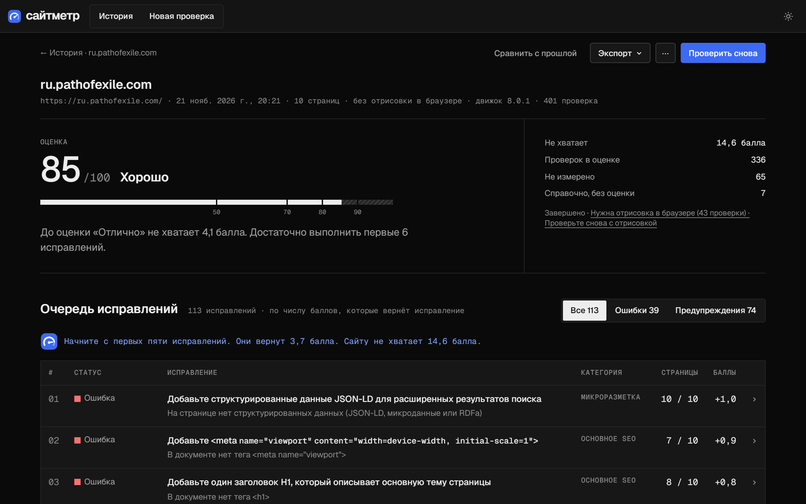

<p align="center">
  
</p>

<h1 align="center">Сайтметр</h1>

<p align="center">
  SEO-аудит сайта на русском — с правилами для Яндекса и 1С-Битрикс и PDF-отчётом для клиента.<br>
  Бесплатно, открытый код, работает на вашем компьютере.
</p>

<p align="center">
  <a href="https://github.com/Quroroyr/sitemetr-seo/releases/latest/download/Sitemetr-8.1.2-win-x64.exe"><b>Скачать для Windows</b></a>
  ·
  <a href="https://quroroyr.github.io/sitemetr-seo/">Сайт проекта</a>
  ·
  <a href="https://github.com/Quroroyr/sitemetr-seo/releases">Все версии</a>
</p>



## Что умеет

- **408 проверок в 22 разделах:** мета-теги, canonical, robots.txt, sitemap, редиректы, скорость и Core Web Vitals, безопасность, доступность, микроразметка, соцсети, готовность к AI-поиску.
- **Очередь исправлений вместо списка ошибок.** У каждой находки есть баллы: насколько вырастет оценка, если её исправить. Сверху — то, что даст больше всего.
- **Раздел «Яндекс».** Тестовая копия на домене хостинга открыта для индексации, нет `Clean-param`, устаревшие `Host` и `Crawl-delay`, нет Яндекс.Метрики.
- **Раздел «1С-Битрикс».** `X-Powered-CMS` выдаёт Битрикс, robots.txt закрывает CSS и JS из `/bitrix/`, служебные адреса (`sessid`, `clear_cache`, `PAGEN_1`), дубли `index.php`, выключенный композитный кеш. Раздел появляется, только если сайт на Битриксе; на остальных он не влияет на оценку.
- **Поисковые запросы.** Перетащите выгрузку из Search Console или Яндекс.Вебмастера (CSV, ZIP или Excel) — Сайтметр разложит запросы на группы: вопросы, инструкции, сравнения, «купить и цены», город, «почти в топе», «много показов — мало кликов». Внутри группы запросы стоят по упущенным кликам, к каждой группе — что сделать на странице и готовый фильтр для Search Console, который работает с кириллицей.
- **PDF-отчёт для клиента:** оценка, пять главных исправлений, оценка по разделам и вся очередь работ с подсказками «как исправить». Плюс экспорт в HTML, Markdown и JSON.
- **Обход сайта** до 1000 страниц: дубли, сироты, цепочки canonical, битые внутренние и внешние ссылки.
- **Всё локально.** Проверки идут с вашего компьютера, история хранится в локальной базе SQLite.

## Установка

1. Скачайте [Sitemetr-8.1.2-win-x64.exe](https://github.com/Quroroyr/sitemetr-seo/releases/latest/download/Sitemetr-8.1.2-win-x64.exe) (около 100 МБ, Windows 10/11, 64 бит).
2. Установщик не подписан платным сертификатом, поэтому Windows SmartScreen предупредит при первом запуске: нажмите «Подробнее» → «Выполнить в любом случае».
3. «Новая проверка» → адрес сайта → «Проверить». Для замеров скорости включите «Core Web Vitals и отрисовка в браузере».

## Консольная версия

Тот же движок для автоматизации и CI. Нужен Node.js 20.18 или новее.

```bash
git clone https://github.com/Quroroyr/sitemetr-seo.git
cd sitemetr-seo
npm ci
npm run build

# одна страница
node dist/cli.js audit https://example.ru

# обход сайта и PDF-отчёт для клиента
node dist/cli.js audit https://example.ru --crawl --max-pages 20 --format pdf -o report.pdf

# веб-панель с историей проверок на http://127.0.0.1:7360
node dist/cli.js serve
```

Форматы вывода: `console`, `json`, `html`, `markdown`, `llm`, `pdf`. Все флаги: `node dist/cli.js audit --help`.

## Сборка установщика

```bash
npm ci
npm run electron:dist:win   # release/Sitemetr-<версия>-win-x64.exe
```

Скрипт сам пересобирает нативный модуль SQLite под Electron. Перед запуском консольной версии или тестов после этого выполните `npm run rebuild:cli`.

## Устройство

- `src/rules/` — правила проверок, по папке на раздел; `src/rules/yandex/` и `src/rules/bitrix/` — правила под рунет.
- `src/i18n/` — русские тексты правил, советов и сообщений.
- `src/search-queries/` — разбор выгрузок запросов и группы-фильтры для вкладки «Запросы».
- `src/reporters/` — отчёты: консоль, HTML, Markdown, JSON, PDF для клиента (`client-report.ts`).
- `ui/` — интерфейс (React), общий для приложения и веб-панели; `electron/` — десктоп-приложение.
- Русские тексты корректно обрабатываются во всех проверках контента: подсчёт слов, ключевые слова, дубли.

## Известные ограничения

- Готовый установщик только для Windows. Консольная версия и веб-панель работают везде, где есть Node.js.
- Движок не использует системный прокси: сайты, доступные только через VPN, проверить не получится, если VPN не работает в режиме всей системы.
- В десктоп-приложении недоступны сравнение с мобильной версией и имитация действий на странице; в консоли и веб-панели они есть.

## Лицензия

MIT, см. [LICENSE](LICENSE). Шрифт Geist — SIL Open Font License 1.1.
